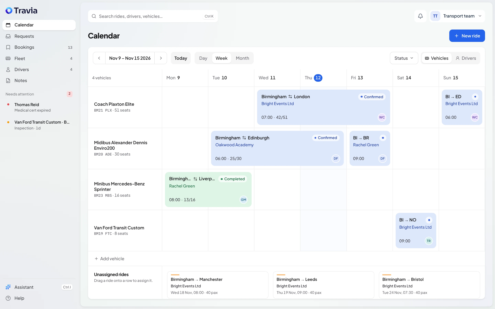
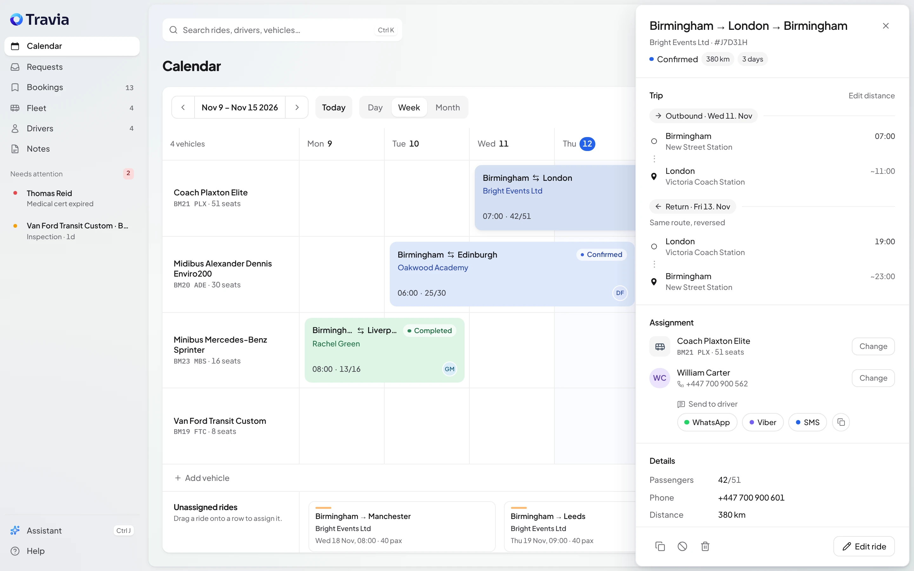
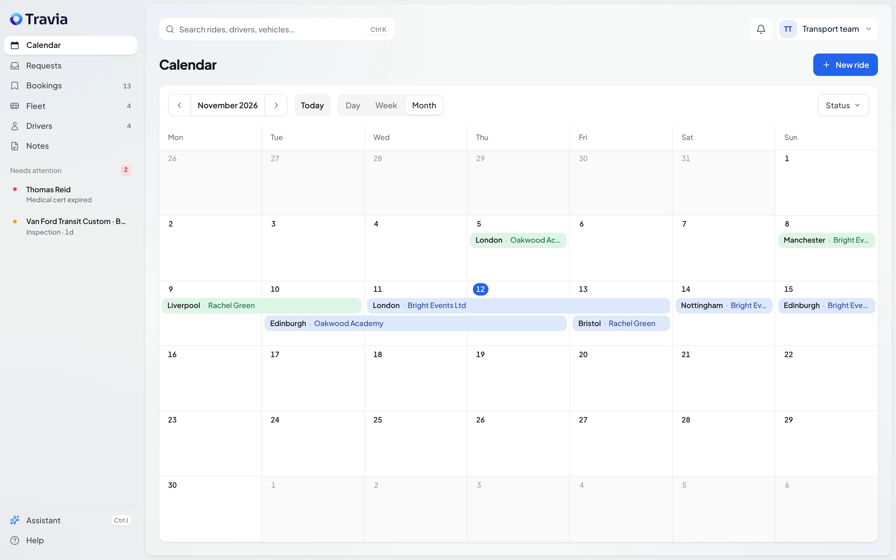
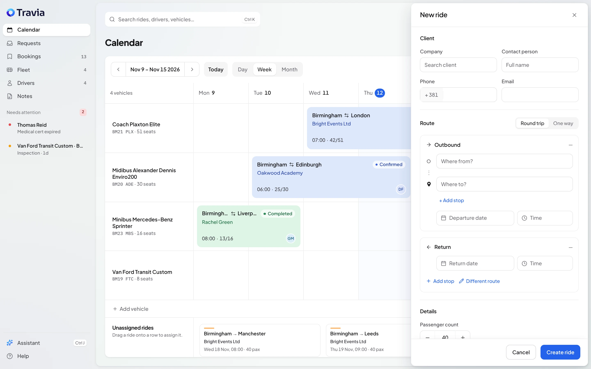
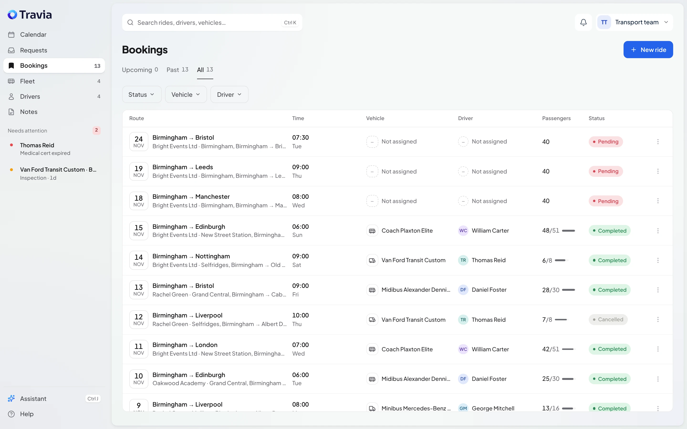
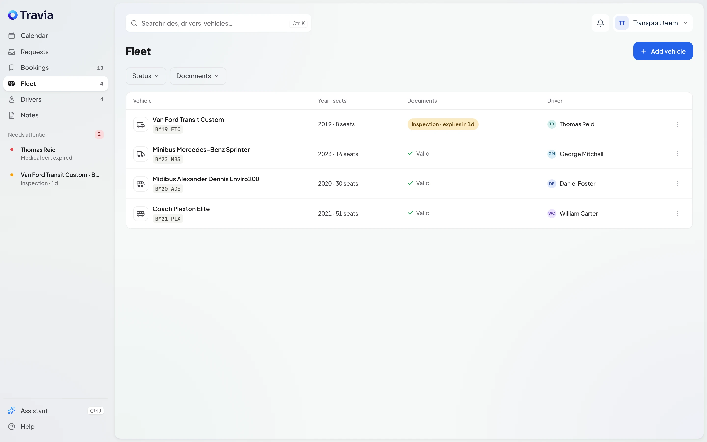
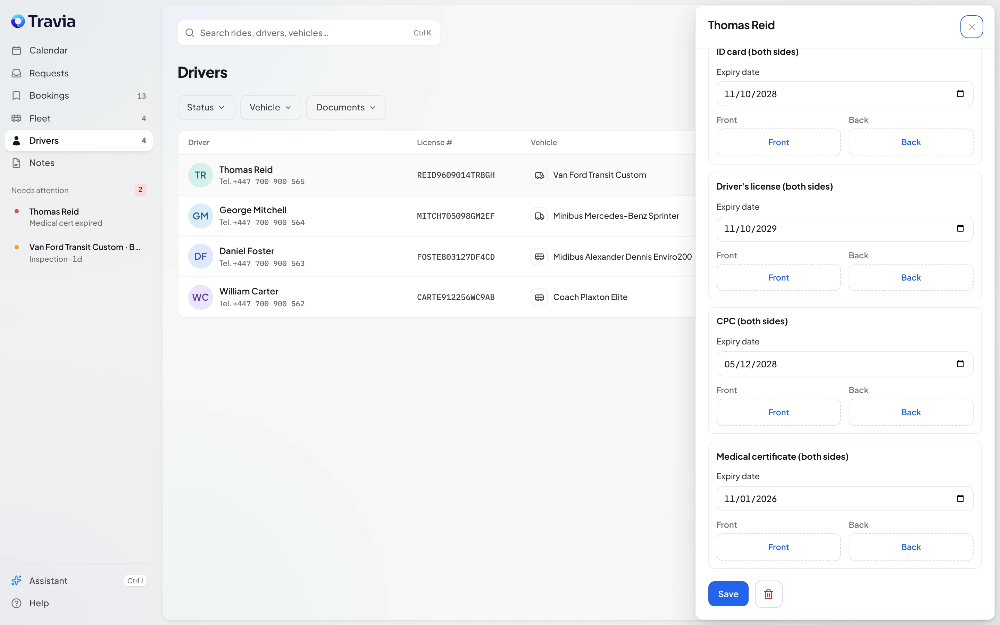
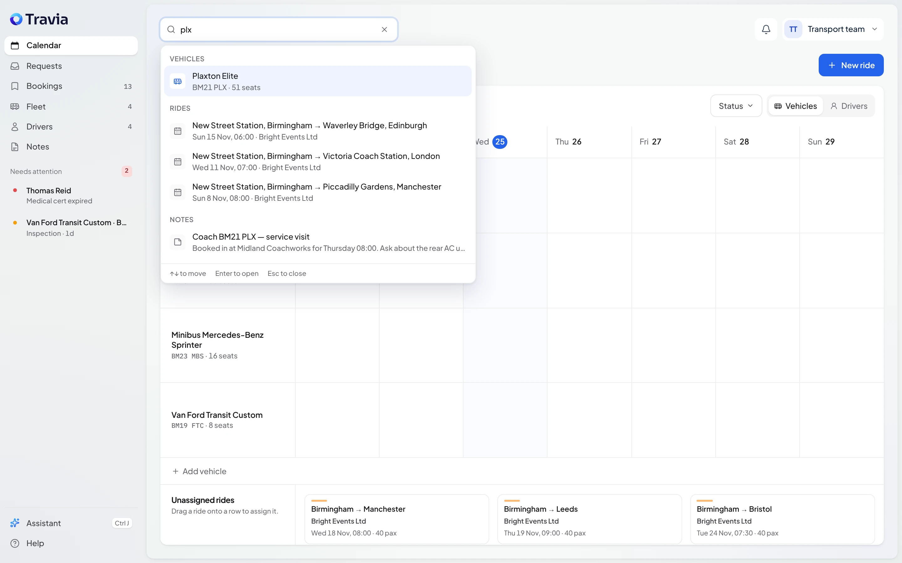

<div align="center">


### Operations platform for coach and transport companies

Bookings, vehicles, drivers, documents and the daily schedule — in one place.

[](https://nextjs.org)
[](https://react.dev)
[](https://www.typescriptlang.org)
[](https://tailwindcss.com)
[](https://www.prisma.io)
[](https://www.postgresql.org)
[](https://docs.anthropic.com)
[](https://vercel.com)

[Live app](#demo-access) · [Screenshots](#screenshots) · [Features](#key-features) · [My role](#my-role)

</div>

<br />



---

## Contents

- [Overview](#overview)
- [The problem](#the-problem)
- [The solution](#the-solution)
- [Key features](#key-features)
- [Screenshots](#screenshots)
- [Technology stack](#technology-stack)
- [Development approach](#development-approach)
- [My role](#my-role)
- [Demo access](#demo-access)
- [Project status](#project-status)
- [Running locally](#running-locally)

---

## Overview

**Travia** is a B2B web platform for coach and transport companies — operators who run coaches, minibuses and vans for schools, event organisers, tour groups and corporate clients. It gives a dispatcher one workspace to plan the week, assign the right vehicle and driver to each ride, keep driver and vehicle documents valid, and produce the paperwork every trip needs.

The product is an MVP: the core operator workflow is implemented end to end and runs as a deployed Next.js application.

## The problem

Small and mid-sized transport operators typically run their business across a patchwork of tools:

- **Spreadsheets and Google Calendar** for the schedule — with no view of which vehicle or driver is actually free, so double-bookings are caught late or not at all.
- **WhatsApp and phone calls** to brief drivers, with ride details retyped by hand for every trip.
- **Word templates and PDFs** for confirmations, contracts and invoices, filled in manually per booking.
- **Paper folders or memory** for document expiry dates — driving licences, CPC cards, medical certificates, vehicle registration and inspections — where a missed date can take a driver or vehicle off the road.

The information exists, but it is scattered, duplicated and easy to get wrong.

## The solution

Travia brings these workflows into a single system built around the ride:

1. **Plan** — every ride lives on one calendar, shown by vehicle or by driver, so availability and conflicts are visible at a glance.
2. **Assign** — vehicles and drivers are assigned directly on the calendar, with a warning when either is already booked.
3. **Brief** — a driver message with the route, time, vehicle, passengers and a map link is generated for WhatsApp, Viber or SMS.
4. **Document** — a booking confirmation, transport contract and invoice are generated automatically for each ride and can be emailed to the client.
5. **Stay compliant** — expiry dates for driver and vehicle documents are tracked, and anything expired or due within 30 days is surfaced in the sidebar.

## Key features

<table>
<tr>
<td valign="top" width="50%">

**Operations calendar**
- Day, week and month views; rows by vehicle or by driver
- Click or drag across empty time to create a ride at that slot
- Drag unassigned rides onto a vehicle or driver to assign them
- Availability check with an "already booked" warning
- Multi-day trips span across days and weeks; status colours and filters

**Rides and bookings**
- Ride form with client lookup, stops, round trips and an optional different return route
- Road distance calculated automatically (OSRM, or Google Routes when configured)
- Suggested price from distance and the company's rates when no price is entered
- Bookings list with upcoming / past / all tabs and status, vehicle and driver filters
- Passenger-vs-seat capacity indicator; edit, duplicate, cancel or remove a ride
- "Send to driver" message for WhatsApp, Viber, SMS or clipboard

**Automated documents**
- Booking confirmation, transport contract and invoice generated as PDFs for every ride
- Regenerated automatically when the ride changes; sequential document numbering
- Download, or email selected documents to the client (Resend)

</td>
<td valign="top" width="50%">

**Fleet management**
- Vehicles with type, plate, seats, amenities and status
- Photo gallery and uploaded vehicle documents
- Registration and technical inspection dates with expiry status

**Driver management**
- Driver profiles with contact details, licence number, availability and assigned vehicles
- ID card, driving licence, CPC and medical certificate — front/back scans with expiry dates
- AI-suggested expiry date read from an uploaded document (Claude, when an API key is set)

**Compliance tracking**
- "Needs attention" list for documents that are expired or expire within 30 days
- Document status chips and filters on the fleet and driver lists

**Workspace**
- Global search (⌘K / Ctrl K) across rides, vehicles, drivers, notes, requests and help articles
- AI Assistant (beta, ⌘J): drafts rides from plain-language requests and answers schedule questions using live data — nothing is created until the user confirms
- Notes with inline images and file attachments, reorderable by drag and drop
- Help centre with searchable FAQs and support contact
- English and Serbian interface

**Accounts and administration**
- Email/password and Google sign-in, password reset by email, rate-limited login
- Company profile with logo, rate per km and fixed fee
- Admin approval of new carrier accounts

</td>
</tr>
</table>

## Screenshots

> Captured from the running application using the repository's fictional seed data (a UK demo company with invented names, `example.com` emails and Ofcom drama-range phone numbers).

<table>
<tr>
<td width="50%">

<p align="center"><b>Ride details</b> — trip legs, assignment, driver message and documents</p>
</td>
<td width="50%">

<p align="center"><b>Month view</b> — multi-day trips across the month</p>
</td>
</tr>
<tr>
<td width="50%">

<p align="center"><b>New ride</b> — client, route with stops and return leg, details</p>
</td>
<td width="50%">

<p align="center"><b>Bookings</b> — every ride with assignment, capacity and status</p>
</td>
</tr>
<tr>
<td width="50%">

<p align="center"><b>Fleet</b> — vehicles with document status and assigned driver</p>
</td>
<td width="50%">

<p align="center"><b>Driver documents</b> — scans and expiry dates per document</p>
</td>
</tr>
<tr>
<td colspan="2" align="center">

<p align="center"><b>Global search</b> — vehicles, rides and notes in one list</p>
</td>
</tr>
</table>

## Technology stack

| Area | Technology |
|---|---|
| Framework | [Next.js 16](https://nextjs.org) (App Router, React Server Components, route handlers) · [React 19](https://react.dev) · TypeScript |
| Styling | [Tailwind CSS 4](https://tailwindcss.com) with a token-based design system (CSS custom properties) · lucide and Heroicons |
| Data | [PostgreSQL](https://www.postgresql.org) · [Prisma 6](https://www.prisma.io) ORM and migrations · [Zod](https://zod.dev) validation |
| Authentication | [Auth.js (NextAuth v5)](https://authjs.dev) — credentials and Google OAuth, bcrypt password hashing |
| Internationalisation | [next-intl](https://next-intl.dev) — English and Serbian |
| Documents | [@react-pdf/renderer](https://react-pdf.org) for confirmations, contracts and invoices |
| Email | [Resend](https://resend.com) — documents to clients, password reset |
| File storage | [Vercel Blob](https://vercel.com/docs/storage/vercel-blob) in production, local disk in development |
| AI | [Anthropic Claude API](https://docs.anthropic.com) — Assistant with tool use; document expiry reading |
| Maps and routing | OpenStreetMap Nominatim and OSRM by default; Google Places and Routes APIs optional |
| Tooling | ESLint (incl. a custom design-token rule) · patch-package · Docker Compose for local Postgres |
| Hosting | [Vercel](https://vercel.com) |

## Development approach

**Design first.** I designed the product — flows, screens and a design system of colour, type, radius and elevation tokens — in **Figma** before writing code.

**AI-assisted implementation.** I then used **Claude Code** to translate the designs into a working **Next.js** application, directing the work feature by feature: describing the intended behaviour and design, reviewing the result in the browser, and iterating until it matched the design and the product requirements.

**Design system in code.** The Figma tokens live as CSS custom properties in [`src/app/globals.css`](src/app/globals.css). A custom ESLint rule (`travia/design-tokens` in [`eslint.config.mjs`](eslint.config.mjs)) fails the lint step if a component introduces a hardcoded colour, an off-scale font size or a one-off radius or shadow, so the implementation stays aligned with the design system as it grows.

**Version control.** The project is managed in **GitHub**, with each feature or fix developed on a branch and merged through a pull request that describes what changed and how it was tested.

## My role

I led the project end to end as **Product Designer and Design Engineer**:

- **Product discovery** — mapping how transport operators plan rides, brief drivers and handle paperwork today, and defining the MVP scope.
- **UX and UI design** — information architecture, user flows and high-fidelity screens for the calendar, ride, fleet, driver and document workflows.
- **Design system** — the token set, components and interaction patterns, carried into code and enforced with linting.
- **Product decisions** — prioritisation, trade-offs and what to defer beyond the MVP.
- **AI-assisted implementation** — building the application with Claude Code, reviewing and testing each change, and managing delivery through GitHub.

## Demo access

| Access | Details |
|---|---|
| **Live application** | **https://travia.live** |
| **Demo email** | `[demo email — to be added]` |
| **Demo password** | `[demo password — to be added]` |

<!-- TODO: replace the placeholders above with a dedicated demo carrier account
     (fictional data, no admin rights). Do not publish admin credentials. -->

The demo account is a carrier workspace populated with fictional data, so you can explore the calendar, rides, fleet, drivers, documents and search. The AI Assistant and document emailing depend on API keys being configured on the deployment.

## Project status

Travia is an **MVP**. The operator workflow described above is implemented and deployed; the items below are either built but switched off, or not yet built.

**Implemented**
- Everything listed under [Key features](#key-features)

**Built, currently switched off**
- **Client marketplace** — client sign-up, trip requests, carrier offers and client bookings are implemented but hidden behind a feature flag ([`src/config/features.ts`](src/config/features.ts)) so the MVP focuses on the operator workspace. The carrier's *Requests* inbox is part of this flow.

**Not yet built / known limitations**
- Creating vehicle and driver unavailability (maintenance, days off) from the UI — the data model and API exist, and the calendar displays such blocks, but there is no screen for adding them yet.
- Phone and tablet layouts — the application is designed for desktop and laptop screens.
- Payments and e-invoicing are out of scope for the MVP.
- The AI Assistant is in beta and requires an Anthropic API key.

## Running locally

**Prerequisites:** Node.js 20.9+ and PostgreSQL 16 (or Docker).

```bash
cp .env.example .env          # fill in AUTH_SECRET; other keys are optional
docker compose up -d          # or point DATABASE_URL at an existing Postgres
npm install
npx prisma migrate dev
npm run db:seed               # fictional demo companies, vehicles, drivers and rides
npm run dev                   # http://localhost:3000
```

The seed script creates demo carrier accounts and an admin account; their emails are printed by the script and their passwords come from the `SEED_*` variables in `.env` (see [`.env.example`](.env.example)). Optional integrations — Google sign-in, the Claude API, Google Maps, Resend email and Vercel Blob — are each enabled by their environment variable and degrade gracefully when it is missing.

<details>
<summary><b>Project structure</b></summary>

```
src/
├── app/                 # Next.js App Router — pages and API route handlers
│   └── [locale]/        # localised routes (en, sr): carrier workspace, auth, admin
├── components/          # UI — calendar, carrier workspace, forms, landing page, shared ui/
├── lib/                 # domain logic — availability, pricing, distance, documents,
│                        # assistant, uploads, validation
├── auth/                # Auth.js configuration
└── i18n/                # next-intl routing
messages/                # en.json, sr.json translations
prisma/                  # schema, migrations and seed data
docs/screenshots/        # README screenshots
```

</details>
